# Phased Implementation Plan (UI-First, Tool-by-Tool)

This plan prioritizes getting the native `gpui-kit` application shell up and running immediately in **Phase 1**, wiring up basic settings and Copilot connectivity in **Phase 2**, and then building **one tool at a time** (splitting larger tools across multiple phases) while introducing backend infrastructure *just-in-time* for the tool that first needs it.

```mermaid
flowchart TD
    P1["Phase 1: App Window, Workspace Shell &\nSingleton Navigation Skeleton (gpui-kit)"]
    P2["Phase 2: Core Settings UI, Keychain Config &\nCopilot Auth / Model Dropdown"]
    P3["Phase 3: T-Shirt Size Estimator\n(+ Resilient JSONL Streamer & Git Worktrees)"]
    P4["Phase 4: Story Writer - Part 1\n(UI + Connectors Settings + Confluence & Ticket Search)"]
    P5["Phase 5: Story Writer - Part 2\n(Story Generation, Ticket Creation & Prompt Validator)"]
    P6["Phase 6: Test Case Writer\n(Interactive Table UI, Generation & Markdown Export)"]
    P7["Phase 7: Story Elaborator - Part 1\n(Interactive Q&A Chat UI, Suggested Chips & Plan Refinement)"]
    P8["Phase 8: Story Elaborator - Part 2\n(Repo Worktree Access & Confluence Link Auto-Discovery)"]
    P9["Phase 9: PR Reviewer - Part 1\n(PR Discovery UI, Disk Phase Loader & Git Checkout)"]
    P10["Phase 10: PR Reviewer - Part 2\n(Parallel Worker Pool, Code Context & Comment Posting)"]
    P11["Phase 11: PR Reviewer - Part 3\n(AI Critic Engine & Existing Thread Replies)"]
    P12["Phase 12: Usage History Dashboard,\nSQLite Telemetry & Desktop Notifications"]

    P1 --> P2 --> P3 --> P4 --> P5 --> P6 --> P7 --> P8 --> P9 --> P10 --> P11 --> P12
```

---

## Phase 1: Application Window, Workspace Shell & Navigation Skeleton
**Objective:** Get a native `gpui-kit` desktop window compiling and running with the full layout chrome, theme switching, and navigation between singleton tool view placeholders.
- **UI & Shell:**
  - Initialize `gpui::Application` and `gpui_kit::init(cx)` with a `1200x890` window and custom integrated titlebar (`Stitch` branding + `Report an Issue` external URL button).
  - Build the persistent **Left Activity Rail** organized by lifecycle group (*Ideation*: T-Shirt Estimator; *Solution Design*: Story Writer, Test Case Writer; *Build*: Story Elaborator; *Review*: PR Reviewer; bottom utility links: *Usage History*, *Settings*).
  - Instantiate one singleton `gpui::Entity<T>` per view in `AppState`. Clicking items in the Activity Rail swaps the active view in the main workspace without dropping background entities.
  - Build the **Footer Status Bar** with version display (`env!("CARGO_PKG_VERSION")`), active background task indicator slot, and a clickable Copilot Auth status indicator slot.

---

## Phase 2: Core Settings UI, Local Persistence & Copilot Connection
**Objective:** Make the Settings view functional for general preferences and GitHub Copilot authentication so that every subsequent tool phase has access to settings and the `ModelDropdown` widget.
- **UI Components:**
  - Build the **Settings View** with its left sub-navigation sidebar (`General`, `Connectors`, `GitHub Copilot`, `Prompts`, `PR Reviewer`) and implement the **General** tab (Theme toggle: `Auto` / `Light` / `Dark`, `Enable Git Worktree Support` switch, and `Worktree Base Directory` folder picker via `rfd` / GPUI path prompt) and **GitHub Copilot** tab (`Copilot Token` input, default `Copilot Model` selector, `Check Auth Status` button, and available models table).
  - Build the shared **`ModelDropdown`** component and the **Startup Copilot Auth Required Modal** (shown if unauthenticated on launch, with instructions for `copilot auth signin` / `gh auth login`).
- **Just-in-Time Infrastructure:**
  - Implement `SettingsStore` (JSON config file in OS app data directory + `keyring` for storing `copilot_token` in the OS Keychain + string trimming on save).
  - Implement the initial `CopilotService` wrapper around the Rust Copilot SDK supporting `check_auth_status()` and cached `list_models()`, wired to the footer status bar and `ModelDropdown`.

---

## Phase 3: T-Shirt Size Estimator (First End-to-End Tool)
**Objective:** Build the **T-Shirt Size Estimator** end-to-end. Because it only requires a local repository path and Copilot, it validates the streaming agent loop and Git worktree isolation without needing any external REST connectors yet.
- **Tool UI (`TShirtEstimatorView`):**
  - **Left Pane:** `Proposed Change Description` textarea, `Local Repository Path` input + Browse button, conditional `Git Branch` input (default `"develop"`), `ModelDropdown`, and `Start Estimation` / `Cancel Estimation` button.
  - **Right Pane:** Idle empty state; live auto-scrolling monospace terminal console (`> <tool status>`) during estimation; and completed view with the 90x90 color-coded `XS`–`XL` size badge, rendered Markdown reasoning, `Copy Result` button, and `Start Over` button.
- **Just-in-Time Infrastructure:**
  - Extend `CopilotService` with `create_session` (`working_directory`, custom tools), `send_and_collect_stream`, the **Resilient JSONL Parser**, the **180s inactivity watchdog timer** (paused during active tool calls) + `TimeoutModal`, the `report_intent` custom tool, and `format_tool_status` (`grep`, `view`, `bash`).
  - Implement `GitService` worktree lifecycle (`check_git_repo`, `get_repo_root`, `git fetch origin <branch>`, `add_worktree`, `remove_worktree`) and wire up the orphaned worktree scanner & `Clean Up` button in `Settings > General`.

---

## Phase 4: Story Writer — Part 1 (UI, Connectors & Autocomplete Search)
**Objective:** Build the Story Writer UI and implement the Confluence and Issue Tracker (Azure DevOps / GitHub) search and fetch capabilities.
- **UI Components:**
  - **Settings > Connectors Tab:** Build the connector cards and configuration modals for **Azure DevOps** (Org, Project, PAT, and `Fetch Types` button populating `Feature Type`, `Story Type`, `Task Type`, `Test Task Title`), **Atlassian Confluence** (URL, Username, API Token), and **GitHub** (Token, Default Owner), plus the **Source Routing** selectors (`Issues Tracker Source`, `Code Source`, `Documentation Source`).
  - **Story Writer View (`StoryWriterView`):**
    - Left Pane: Debounced (400ms) autocomplete search combobox for `Page Search (Confluence)`, debounced autocomplete combobox for `Feature ID / Search`, `Additional Context` textarea, `ModelDropdown`, `Generate Stories` button, and `Fetched Page` preview card.
    - Right Pane: Scrollable Story Cards list with expand/collapse state, status badges (`Created`, `Discarded`), rendered Markdown Acceptance Criteria, and inline edit mode.
- **Just-in-Time Infrastructure:**
  - Store `azure_pat`, `github_token`, and `confluence_token` in the OS Keychain via `SettingsStore`.
  - Implement `ConfluenceClient` (`fetch_page`, `search_pages` with CQL & exact numeric ID match).
  - Implement `IssueTrackerProvider` trait + `AzureDevOpsClient` and `GitHubClient` read methods (`fetch_ticket`, `search_tickets`, `get_work_item_types`).

---

## Phase 5: Story Writer — Part 2 (Story Generation, Ticket Creation & Prompt Validator)
**Objective:** Complete the Story Writer by wiring up Copilot JSONL story streaming, ticket creation in Azure DevOps / GitHub, and custom prompt validation.
- **Functionality & Infrastructure:**
  - Implement `StoryWriterService::generate_stories` and `build_story_prompt`, streaming parsed `StoryData` JSONL objects directly into `StoryWriterView`'s card list.
  - Implement `IssueTrackerProvider::create_ticket` (with `Hierarchy-Reverse` parent linking in Azure DevOps, sub-issue linking in GitHub, and Stitch/Copilot attribution footers) and wire it to each Story Card's `Create Story` action.
  - **Settings > Prompts Tab (Story Writer):** Build the prompt customization tab for Story Writer fields (`General`, `Title`, `Description`, `Acceptance Criteria`, `Notes`) + `Reset Defaults` and the **`Check Prompt` Complexity Validator** (`PromptComplexityService` + feedback modal).

---

## Phase 6: Test Case Writer (Interactive Table, Generation & Publishing)
**Objective:** Build the **Test Case Writer** tool on top of the `IssueTrackerProvider` from Phases 4–5.
- **Tool UI (`TestCaseWriterView`):**
  - **Left Pane:** Debounced `Ticket Search` autocomplete combobox, `Additional Context` textarea, `ModelDropdown`, `Generate Test Cases` button, and `Fetched Ticket` summary card.
  - **Right Pane:** Interactive Test Case data table (`ID`, `Description`, `Pre-conditions`, `Steps`, `Expected Result`, `Priority` pill badge, and `Actions`), supporting drag-and-drop / keyboard row reordering (dynamically re-numbering active rows `TC-1..N`), soft-deletion with inline `"Test scenario deleted — Undo"`, and `Copy Table`.
  - **Footer Actions:** `Add as Comment` and `Add as Testing Task`.
- **Functionality & Settings:**
  - Implement `TestCaseWriterService::generate_test_cases`, `build_test_case_prompt`, and GFM Markdown table serialization.
  - Implement `IssueTrackerProvider::add_comment` and wire up both `Add as Comment` and `Add as Testing Task` (tracking `edited: true` when rows are reordered or deleted).
  - Add the **Test Case Writer** sub-tab under `Settings > Prompts` with `Check Prompt` validation support.

---

## Phase 7: Story Elaborator — Part 1 (Interactive Q&A UI & Multi-Turn Session Loop)
**Objective:** Build the conversational **Story Elaborator** UI and stateful multi-turn Copilot session lifecycle (operating in ticket-text mode first).
- **Tool UI (`StoryElaboratorView`):**
  - **Left Pane:** Debounced `Ticket Search` autocomplete, optional `Local Repository Path` picker & `Git Branch` input, `Additional Context` textarea, `ModelDropdown`, and `Start Elaboration` / `Cancel Session` button.
  - **Right Pane:**
    - Conversational feed rendering monospace tool status pills, Copilot question chat bubbles, user reply bubbles, and collapsible `Generated Plan (Refined)` history cards.
    - Reply footer with clickable **Suggested Answer Chips** (`suggestedAnswers`) above the text input.
    - Completed Plan view with rendered Markdown, `Copy Plan`, expandable **Refine Plan** instruction bar, `Start Over`, and `Add as Comment on Ticket`.
- **Functionality & Settings:**
  - Implement `StoryElaboratorService` with stateful multi-turn session retention (`start_elaboration`, `send_answer`, `stop_elaboration`), handling `status`, `question`, and `plan` JSONL messages and iterative plan refinement turns.
  - Add the **Story Elaborator** sub-tab under `Settings > Prompts`.

---

## Phase 8: Story Elaborator — Part 2 (Codebase Worktree & Confluence Tool Integration)
**Objective:** Complete the Story Elaborator by enabling local repository inspection via isolated Git worktrees and automatic Confluence page discovery.
- **Functionality & Infrastructure:**
  - Wire `StoryElaboratorService` to `GitService` worktrees (`<repo>_ticket_<id>`) when a repository path is provided, enabling Copilot's built-in file/grep tools in the worktree (or locking `available_tools` to custom tools only when no repo path is given).
  - Implement URL extraction on ticket descriptions/AC together with `ConfluenceClient::is_doc_page_url` and `extract_page_id` to populate `known_docs`.
  - Implement and register the `request_documentation` custom Copilot tool (with per-session document ID deduplication).

---

## Phase 9: PR Reviewer — Part 1 (PR Discovery UI, Disk Phase Loader & Checkout)
**Objective:** Build the PR Reviewer selection and checkout workflow, local `~/.stitch/pr-reviewer` phase/template loader, and Git PR branch checkout.
- **Tool UI (`PrReviewerView` — Setup & Checkout Panel):**
  - Build the **PR Selector** panel with `Assigned to Me`, `Created by Me`, `All Active PRs` (with search filter), and `Manual ID/URL` tabs.
  - Build the **PR Details & Checkout** panel displaying PR metadata, local repository path picker (auto-remembered per repository name and verified/resolved to git root), grouped review phases checklist (with model availability checks and template error indicators), `Critic` toggle, and `Fetch & Checkout PR` button (collapsing the setup header once checked out).
- **Just-in-Time Infrastructure:**
  - Implement `CodeReviewProvider` trait + `AzureDevOpsCodeReviewClient` and `GitHubCodeReviewClient` discovery methods (`parse_pr_url`, `parse_remote_url`, `get_pr_details`, `get_project_prs`, `get_linked_tickets`).
  - Implement `~/.stitch/pr-reviewer/` loader (`config.json`, `phases/*.md` YAML frontmatter parser, `templates/*.md` `<%content%>` substitution with traversal validation, and 3-tier deterministic sorting) + `Open Phases Folder` action.
  - Extend `GitService` with `fetch_pr`, `get_current_ref`, `restore_ref`, `has_uncommitted_changes` (triggering `DirtyRepoModal` when worktrees are disabled), `get_diff_target` (`HEAD~1` merge commit detection), and `get_diff_files`.

---

## Phase 10: PR Reviewer — Part 2 (Parallel Multi-Phase Review & Code Context UI)
**Objective:** Run multi-phase code reviews in parallel across a Tokio worker pool and display live phase progress, code context blocks, and comment posting controls.
- **Tool UI (`PrReviewerView` — Progress & Comments Workspace):**
  - **Settings > PR Reviewer Tab:** Personas editor (up to 5 personas) and default Review Agent Parallelism slider (`1 ..= cpu_count - 2`).
  - **Left Review Column:** Model selector, Parallelism slider, Persona selector (auto-remembered per PR author), Specific Instructions textarea, and `Start Code Review` button—transitioning during execution to the live Phase Progress checklist (`Pending`, `Running` with current tool intent, `Done (N draft comments)`, `Skipped`).
  - **Right Comments Column:** Streaming comment cards showing phase badge, `file:line` header, dark syntax/line-numbered code context snippet (`code_lines` with yellow target line highlight), rendered Markdown comment, edit modal/inline editor, `Dismiss`, and `Post` button.
- **Functionality & Infrastructure:**
  - Implement `PrReviewerService::review_pr`: OS sleep prevention (`keepawake`), linked story & Confluence doc attachment (`attach: story` / `attach: description`), `globset` `include`/`exclude` file filtering (emitting `PhaseSkip` when 0 files match), parallel Tokio worker pool, and `extract_file_context` enriching `type: "line"` comments.
  - Implement `CodeReviewProvider::post_pr_comment` for general and right-side line-anchored PR comments.

---

## Phase 11: PR Reviewer — Part 3 (The AI Critic Phase & Existing Thread Replies)
**Objective:** Add the AI Critic evaluation pass and support inspecting and replying to existing PR comment threads.
- **Functionality & UI:**
  - Implement `CodeReviewProvider::get_pr_comment_threads` and the `get_existing_comments` custom Copilot tool (supporting file + line range or keyword searches across active and resolved threads).
  - Implement `PrReviewerService::critique_comments` using `build_critic_prompt` and `config.json`'s `criticInstruction`, parsing `approve`, `edit`, `reject`, `merge`, and `reply` JSONL decisions (re-extracting `code_lines` when a comment is relocated and reactivating resolved threads on reply).
  - Add the `Critiqued` vs. `Unvalidated` segmented toggle in `PrReviewerView`, Critic status badges (`Approved`, `Edited by Critic`, `Merged by Critic`, `Reply to Thread #ID`), `Reply` button behavior, and the collapsible `Rejected Comments` section with rejection reason badges.

---

## Phase 12: Usage History Dashboard, SQLite Telemetry & Native Polish
**Objective:** Complete the application with local SQLite token/usage tracking across all tools, the Usage History analytics view, post-run usage toasts, and desktop notifications.
- **UI & Infrastructure:**
  - Implement `UsageDatabase` (`rusqlite` `history.db` in WAL mode, `usage_sessions` and `llm_usages` tables, 2-second delayed startup cleanup pruning records older than 30 days, and push counters) and wire session logging into all 5 tools.
  - Build the shared **`UsageStatsToast`** and **`UsageDetailsModal`** (displaying per-phase/turn input, output, cached tokens, and model billing multipliers after each generation run).
  - Build the **`UsageHistoryView`** with the 4 KPI summary cards (`Total Runs`, `Input Tokens`, `Output Tokens`, `Cache Savings %`), search and tool filter bar, `Clear All History` two-step confirmation button, expandable session accordion with the **Context Size Relative Visualizer** bar, and LLM usage breakdown table.
  - Add unfocused window desktop notifications (`notify-rust`) and window progress bar updates during long-running operations.
