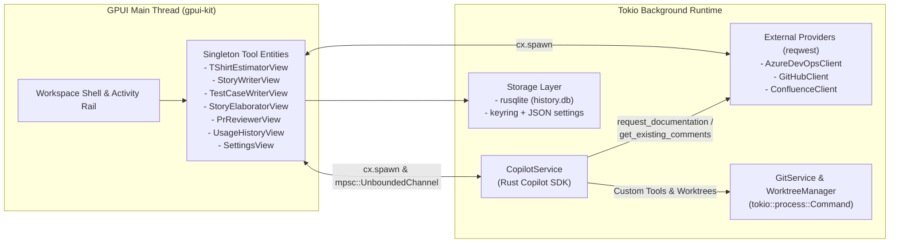
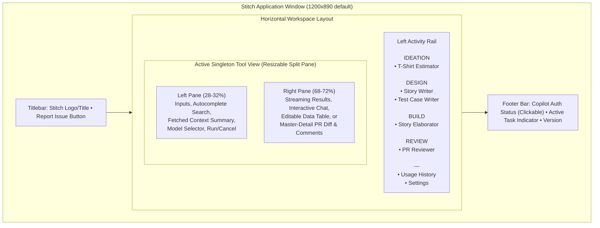

# Stitch: Rust + `gpui-kit` Porting Specification

This document is a complete, standalone specification for building **Stitch** in native **Rust** using **`gpui-kit`** (`gpui` + `gpui_kit`) and the **Rust GitHub Copilot SDK** (`github-copilot-sdk` / `copilot_sdk`).

It is structured so that the core infrastructure and each individual functional tool (**T-Shirt Size Estimator**, **Story Writer**, **Test Case Writer**, **Story Elaborator**, **PR Reviewer**, **Settings & Prompt Validator**, and **Usage History**) can be built and verified independently in a new Rust project.

---

## 1. Architecture & Crate Stack

### 1.1 Architectural Shift: Dual-Process Electron $\rightarrow$ Unified Rust Process

In the original Electron application, Stitch split state across a Chromium Renderer process and a Node.js Main process bridged by `ipcMain.handle` and `ipcRenderer.on`.

In Rust with `gpui-kit`:
- **Single Native Process:** The UI runs on the main thread via GPUI's GPU-accelerated rendering engine, while background I/O (HTTP calls, Git commands, SQLite queries, and Copilot SDK sessions) runs on a multi-threaded `tokio` runtime.
- **Singleton Tool Entities:** Each tool is instantiated as a single `gpui::Entity<T>` owned by the application shell. Switching tools in the navigation UI swaps the active view in the workspace without dropping the underlying entity—meaning active Copilot sessions and Git worktrees keep running seamlessly in the background.
- **Typed Async Channels Instead of IPC:** Electron's string-based IPC events (`story-line`, `elaboration-line`, etc.) are replaced by strongly-typed `tokio::sync::mpsc` (or `flume`) channels that stream parsed Rust enums directly into GPUI entity update loops (`view.update(&mut cx, ...)` + `cx.notify()`).
- **No Copilot CLI Installer / Node Detection:** The Electron version required `copilotDetector.ts`, `check-environment`, and `install-copilot-cli` to work around Electron's read-only `app.asar` packaging limitations when spawning Node.js child processes. The Rust Copilot SDK handles runtime management natively, so all Node.js/NPM detection and CLI installation flows are completely omitted.
- **Clean-Slate Storage:** The Rust application starts with a fresh SQLite database (`history.db`) and fresh settings/keychain storage (no legacy Electron config/DB migration code).



### 1.2 Target Rust Dependencies (`Cargo.toml`)

| Concern | Recommended Crates | Purpose |
| :--- | :--- | :--- |
| **UI Framework** | `gpui`, `gpui_kit` | Windowing, layout, theme tokens, inputs, tables, split panes, modals, markdown |
| **Copilot Agent** | `github-copilot-sdk` (or `copilot_sdk`) | Programmatic Copilot agent sessions, streaming deltas, custom tools, model list |
| **Async & Streams** | `tokio` (`full`), `futures`, `async-trait` | Background task execution, worker pools, `mpsc` channels, provider traits |
| **HTTP & Serialization** | `reqwest` (`json`, `rustls-tls`), `serde`, `serde_json`, `serde_yaml` | REST API clients (Azure DevOps, GitHub, Confluence), JSONL parsing, frontmatter |
| **Database** | `rusqlite` (`bundled`) | Local `history.db` SQLite database in WAL mode |
| **Config & Secrets** | `directories`, `keyring`, `base64` | OS app data paths, native OS Keychain for PATs/tokens |
| **Git & Filesystem** | `globset`, `tempfile`, `walkdir`, `url`, `regex` | Glob matching for PR review phases, URL parsing, path validation |
| **OS Integration** | `rfd`, `notify-rust`, `keepawake`, `open` | Directory picker, desktop notifications, sleep prevention during PR reviews, open URLs |

### 1.3 Recommended Project Structure

```text
stitch/
├── Cargo.toml
└── src/
    ├── main.rs                         # GPUI app entry point, window init, global services
    ├── app_state.rs                    # Global state container, singleton entity handles
    ├── types.rs                        # Shared domain structs & enums
    ├── infrastructure/
    │   ├── mod.rs
    │   ├── constants.rs                # Attribution footers
    │   ├── copilot/
    │   │   ├── mod.rs                  # CopilotService, session factory, resilient JSONL streamer
    │   │   └── tools.rs                # report_intent, request_documentation, get_existing_comments, tool formatter
    │   ├── database.rs                 # UsageDatabase (rusqlite)
    │   ├── git.rs                      # GitService & WorktreeManager
    │   ├── settings.rs                 # SettingsStore (JSON + keyring)
    │   └── providers/
    │       ├── mod.rs                  # IssueTrackerProvider, CodeReviewProvider, DocumentationProvider traits
    │       ├── azure_devops.rs         # Azure DevOps Work Items & Git PR REST client
    │       ├── github.rs               # GitHub Issues & PRs REST client
    │       └── confluence.rs           # Atlassian Confluence REST client
    ├── ui/
    │   ├── mod.rs
    │   ├── shell.rs                    # Workspace Shell (Activity Rail, Header, Content Pane, Footer Status Bar)
    │   └── components/                 # Shared widgets (ModelDropdown, AutocompleteInput, UsageToast, UsageModal)
    └── features/                       # Independently buildable vertical slices
        ├── mod.rs
        ├── tshirt_estimator/
        │   ├── mod.rs
        │   ├── service.rs
        │   ├── prompts.rs
        │   └── view.rs
        ├── story_writer/
        │   ├── mod.rs
        │   ├── service.rs
        │   ├── prompts.rs
        │   └── view.rs
        ├── test_case_writer/
        │   ├── mod.rs
        │   ├── service.rs
        │   ├── prompts.rs
        │   └── view.rs
        ├── story_elaborator/
        │   ├── mod.rs
        │   ├── service.rs
        │   ├── prompts.rs
        │   └── view.rs
        ├── pr_reviewer/
        │   ├── mod.rs
        │   ├── service.rs
        │   ├── phases.rs
        │   ├── prompts.rs
        │   └── view.rs
        ├── settings/
        │   ├── mod.rs
        │   ├── prompt_validator.rs
        │   └── view.rs
        └── history/
            ├── mod.rs
            └── view.rs
```

---

## 2. UI Paradigm & Flow Redesign for `gpui-kit`

### 2.1 Core UI Principles
1. **Persistent Activity Rail + Singleton Tool Views:**
   - Replace the full-page 4-column web menu (`Menu.tsx`) and destructive React Router navigation with a persistent **Left Activity Rail** (grouped by lifecycle stage: *Ideation*, *Solution Design*, *Build*, *Review*, plus *History* and *Settings* at the bottom).
   - Each tool has **one singleton instance** (`Entity<T>`) initialized at startup.
   - Navigating between tools in the Activity Rail simply switches which singleton `Entity<T>` is rendered in the main content area.
   - If a tool is actively running in the background (e.g., PR Reviewer running 6 parallel phases, or Story Elaborator waiting on a tool call), its icon in the Activity Rail displays a live activity spinner badge.
2. **Independent, Self-Contained Tools:**
   - Each tool manages its own inputs, execution state, and results without complex cross-tool handovers.
   - Within each tool, replace web-style multi-card vertical scrolling with native **Resizable Split Panes** (`gpui-kit` split pane):
     - **Left Pane (Configuration & Context):** Compact form controls, debounced autocomplete search inputs, fetched ticket/page context preview, model dropdown, and primary action button.
     - **Right Pane (Workspace / Output):** Live terminal/intent feed, interactive Q&A chat, editable data table, or master-detail code review diff viewer.
3. **Global Chrome (Titlebar & Status Footer):**
   - **Integrated Titlebar:** Custom traffic-light inset on macOS / custom titlebar controls on Windows, app title (`Stitch`), and a `Report Issue` button (`https://github.com/thealternator89/stitch/issues`).
   - **Footer Status Bar:**
     - Left: Clickable **Copilot Connection Indicator** (`Checking Auth...` / `Copilot Connected (@login)` in green / `Copilot Disconnected` in amber; clicking re-runs `check_auth_status`).
     - Center: Active background task status (if any tool is currently running).
     - Right: App version (`Version X.Y.Z`) and non-intrusive update notification toast when `current_version != last_run_version`.
   - **Startup Auth Overlay:** If `check_auth_status` on startup reports unauthenticated or error, display a dismissible modal explaining how to run `copilot auth signin` or `gh auth login`, or configure a token in `Settings > GitHub Copilot`, with `Check Again` and `Close` buttons.



---

## 3. IPC-to-Rust Translation Matrix

All 38 Electron `ipcMain.handle` calls and 5 streaming `ipcRenderer.on` channels map to the following Rust methods and channels:

| Original Electron IPC | Rust Equivalent (`Service::method`) | Return / Stream Type |
| :--- | :--- | :--- |
| `get-settings` | `SettingsStore::load()` | `AppSettings` |
| `save-settings` | `SettingsStore::save(&mut self, settings, &mut cx)` | `Result<()>` |
| `get-history` | `UsageDatabase::get_history(&self)` | `Result<Vec<DbSession>>` |
| `clear-history` | `UsageDatabase::clear_history(&self)` | `Result<()>` |
| `get-version-status` | `SettingsStore::check_and_update_version(&mut self)` | `UpdateStatus` |
| `open-external` | `open::that(url)` / `cx.open_url(&url)` | `Result<()>` |
| `select-directory` | `cx.prompt_for_paths(PathPromptOptions { directories: true, .. })` | `Option<PathBuf>` |
| `show-notification` | `NotificationService::show_if_unfocused(window, title, body)` | `Result<()>` |
| `set-window-progress` | Native taskbar/dock progress + footer progress bar | `()` |
| `get-cpu-count` | `std::thread::available_parallelism()` | `usize` |
| `check-environment` | **Omitted** (Not needed with Rust Copilot SDK) | N/A |
| `install-copilot-cli` | **Omitted** (Not needed with Rust Copilot SDK) | N/A |
| `check-copilot-auth` | `CopilotService::check_auth_status(&self, token)` | `Result<CopilotAuth>` |
| `list-copilot-models` | `CopilotService::list_models(&self, token)` | `Result<Vec<CopilotModel>>` |
| `check-prompt-complexity` | `PromptComplexityService::check(&self, kind, prompts, settings)` | `Result<String>` |
| `fetch-ticket` | `IssueTrackerProvider::fetch_ticket(&self, id)` | `Result<TicketData>` |
| `search-tickets` | `IssueTrackerProvider::search_tickets(&self, query, kind)` | `Result<Vec<TicketData>>` |
| `get-azure-work-item-types` | `AzureDevOpsClient::get_work_item_types(&self, project)` | `Result<Vec<String>>` |
| `add-comment` | `IssueTrackerProvider::add_comment(&self, id, text, edited)` | `Result<()>` (+ DB `record_push`) |
| `create-ticket` | `IssueTrackerProvider::create_ticket(&self, kind, parent_id, data, edited)` | `Result<()>` (+ DB `record_push`) |
| `fetch-confluence-page` | `DocumentationProvider::fetch_page(&self, page_id)` | `Result<DocPageData>` |
| `search-confluence-pages` | `DocumentationProvider::search_pages(&self, query)` | `Result<Vec<DocPageData>>` |
| `generate-stories` + `on('story-line')` | `StoryWriterService::generate_stories(..., tx)` | `mpsc::UnboundedReceiver<StoryData>` $\rightarrow$ `Result<CopilotResult<usize>>` |
| `generate-test-cases` + `on('test-case-line')` | `TestCaseWriterService::generate_test_cases(..., tx)` | `mpsc::UnboundedReceiver<TestCaseItem>` $\rightarrow$ `Result<CopilotResult<usize>>` |
| `start-story-elaboration` + `on('elaboration-line')` | `StoryElaboratorService::start_elaboration(..., tx)` | `mpsc::UnboundedReceiver<ElaborationEvent>` $\rightarrow$ `Result<i64>` |
| `send-elaboration-answer` | `StoryElaboratorService::send_answer(&mut self, ticket_id, answer, tx)` | `Result<()>` |
| `stop-story-elaboration` | `StoryElaboratorService::stop_elaboration(&mut self, ticket_id)` | `Result<Option<CopilotUsage>>` |
| `start-tshirt-estimation` + `on('tshirt-estimation-line')` | `TShirtEstimatorService::start_estimation(..., tx)` | `mpsc::UnboundedReceiver<EstimationEvent>` $\rightarrow$ `Result<EstimationSessionResult>` |
| `stop-tshirt-estimation` | `TShirtEstimatorService::stop_estimation(&mut self, session_id)` | `Result<Option<CopilotUsage>>` |
| `pr-reviewer:get-details` | `PrReviewerService::get_pr_details(&self, repo_path, pr_url_or_id)` | `Result<PrMetadata>` |
| `pr-reviewer:checkout` | `PrReviewerService::checkout_and_diff(&mut self, repo_path, pr_num, repo_name)` | `Result<String>` (`commit_sha`) |
| `pr-reviewer:get-diff-files` | `GitService::get_diff_files(&self, effective_path, target_branch)` | `Result<Vec<PrDiffFile>>` |
| `pr-reviewer:get-file-diff` | `GitService::get_file_diff(&self, effective_path, target_branch, file)` | `Result<String>` |
| `pr-reviewer:search-prs` | `CodeReviewProvider::get_project_prs(&self, search_type)` | `Result<Vec<PrMetadata>>` |
| `pr-reviewer:get-phases` | `PrReviewerService::load_phases_from_disk(&self)` | `Result<Vec<ReviewPhase>>` |
| `pr-reviewer:open-directory` | `open::that(home_dir.join(".stitch/pr-reviewer"))` | `Result<bool>` |
| `pr-reviewer:check-worktrees` | `PrReviewerService::check_worktrees(&self, base_dir)` | `WorktreeCheckResult` |
| `pr-reviewer:clean-worktrees` | `PrReviewerService::clean_worktrees(&mut self, base_dir)` | `WorktreeCleanResult` |
| `pr-reviewer:review` + `on('pr-reviewer:review-line')` | `PrReviewerService::review_pr(..., tx)` | `mpsc::UnboundedReceiver<PrReviewEvent>` $\rightarrow$ `Result<CopilotResult<Vec<ReviewComment>>>` |
| `pr-reviewer:critique-comments` | `PrReviewerService::critique_comments(..., tx)` | `Result<CopilotResult<Vec<ReviewComment>>>` |
| `pr-reviewer:post-comment` | `PrReviewerService::post_pr_comment(&self, repo_path, pr_id, comment)` | `Result<()>` (+ DB `increment_pushed_comment_count`) |
| `pr-reviewer:get-repo-path-history` / `save` | `SettingsStore::get_repo_path(repo)` / `save_repo_path(repo, path)` | `Option<PathBuf>` / `Result<()>` |
| `pr-reviewer:get-author-persona` / `save` | `SettingsStore::get_author_persona(author)` / `save_author_persona(author, name)` | `Option<String>` / `Result<()>` |
| `pr-reviewer:verify-repo-path` | `GitService::verify_repo_path(&self, path)` | `RepoVerifyResult` |

---

## 4. Shared Infrastructure Specifications

### 4.1 Core Domain Types (`src/types.rs`)

```rust
use serde::{Deserialize, Serialize};
use std::collections::HashMap;
use std::path::PathBuf;

#[derive(Debug, Clone, Serialize, Deserialize)]
#[serde(rename_all = "camelCase")]
pub struct AppSettings {
    pub version: u32,
    pub feature_type: String,      // Default: "Feature"
    pub story_type: String,        // Default: "Product Backlog Item"
    pub task_type: String,         // Default: "Task"
    pub test_task_title: String,   // Default: "Testing"
    pub connectors: ConnectorsConfig,
    pub sources: SourcesConfig,
    #[serde(skip)]                 // Stored in OS Keychain via `keyring`
    pub copilot_token: Option<String>,
    pub copilot_model: String,     // Default: "auto"
    pub theme: ThemeMode,          // Auto | Light | Dark
    pub git_worktree_enabled: bool,
    pub git_worktree_base_dir: Option<PathBuf>,
    pub max_parallelism: Option<usize>,
    pub prompts: CustomPromptsConfig,
    pub pr_reviewer: PrReviewerSettingsConfig,
    #[serde(default)]
    pub repo_paths: HashMap<String, PathBuf>,
    #[serde(default)]
    pub author_personas: HashMap<String, String>,
    pub last_run_version: Option<String>,
}

#[derive(Debug, Clone, Copy, PartialEq, Eq, Serialize, Deserialize, Default)]
#[serde(rename_all = "lowercase")]
pub enum ThemeMode {
    #[default]
    Auto,
    Light,
    Dark,
}

#[derive(Debug, Clone, Default, Serialize, Deserialize)]
#[serde(rename_all = "camelCase")]
pub struct ConnectorsConfig {
    pub atlassian: AtlassianConfig,
    pub azure_dev_ops: AzureDevOpsConfig,
    pub github: GitHubConfig,
}

#[derive(Debug, Clone, Default, Serialize, Deserialize)]
pub struct AtlassianConfig {
    pub url: String,
    pub username: String,
    #[serde(skip)] // Stored in OS Keychain
    pub token: Option<String>,
}

#[derive(Debug, Clone, Default, Serialize, Deserialize)]
pub struct AzureDevOpsConfig {
    pub org: String,
    pub project: String,
    #[serde(skip)] // Stored in OS Keychain
    pub pat: Option<String>,
}

#[derive(Debug, Clone, Default, Serialize, Deserialize)]
pub struct GitHubConfig {
    pub owner: String,
    #[serde(skip)] // Stored in OS Keychain
    pub token: Option<String>,
}

#[derive(Debug, Clone, Serialize, Deserialize)]
pub struct SourcesConfig {
    pub issues: String, // "azureDevOps" | "github" | ""
    pub code: String,   // "azureDevOps" | "github" | ""
    pub docs: String,   // "atlassian" | ""
}

#[derive(Debug, Clone, Default, Serialize, Deserialize)]
#[serde(rename_all = "camelCase")]
pub struct TicketData {
    pub id: Option<String>,
    pub title: String,
    pub description: String,
    pub acceptance_criteria: Option<String>,
}

#[derive(Debug, Clone, Default, Serialize, Deserialize)]
pub struct DocPageData {
    pub id: String,
    pub title: String,
    pub body: String,
}

#[derive(Debug, Clone, Default, Serialize, Deserialize)]
#[serde(rename_all = "camelCase")]
pub struct CopilotUsage {
    pub input_tokens: u64,
    pub output_tokens: u64,
    pub cache_read_tokens: u64,
    pub cost: f64,
    pub model: Option<String>,
    pub phases: Option<Vec<PhaseUsage>>,
}

#[derive(Debug, Clone, Serialize, Deserialize)]
#[serde(rename_all = "camelCase")]
pub struct PhaseUsage {
    pub phase_title: String,
    pub model: String,
    pub input_tokens: u64,
    pub output_tokens: u64,
    pub cache_read_tokens: u64,
    pub cost: f64,
    pub multiplier: f64,
}

#[derive(Debug, Clone, Serialize, Deserialize)]
pub struct CopilotResult<T> {
    pub result: T,
    pub usage: CopilotUsage,
    pub db_session_id: Option<i64>,
}
```

### 4.2 Attribution Constants (`src/infrastructure/constants.rs`)

Whenever Stitch posts comments or creates work items/issues on Azure DevOps or GitHub, it appends an attribution block:

```rust
pub const STITCH_ATTRIBUTION: &str =
    "Stitch<sup>[^](https://github.com/thealternator89/stitch/#readme)</sup>";
pub const COPILOT_ATTRIBUTION: &str =
    "GitHub Copilot<sup>[^](https://github.com/features/copilot)</sup>";

pub fn get_attribution_statement(edited: bool) -> String {
    if edited {
        format!("> Assisted by {STITCH_ATTRIBUTION} and {COPILOT_ATTRIBUTION}.")
    } else {
        format!("> Generated with {STITCH_ATTRIBUTION} and {COPILOT_ATTRIBUTION}.")
    }
}
```

### 4.3 Copilot Service, Resilient JSONL Parser & Custom Tools (`src/infrastructure/copilot/`)

#### Resilient JSONL Stream Parser
LLMs occasionally emit prefix text before JSON objects or deliver multiple JSON objects in a single chunk. The parser buffers incoming deltas and extracts balanced `{ ... }` JSON objects:

```rust
pub fn parse_resilient_jsonl<F>(buffer: &str, mut on_line: F) -> String
where
    F: FnMut(&str),
{
    let mut temp = buffer.to_string();
    loop {
        let Some(start_idx) = temp.find('{') else {
            // Discard non-JSON prefix noise if no '{' exists
            return String::new();
        };
        if start_idx > 0 {
            temp.drain(..start_idx);
        }

        let mut matched_end = None;
        for (idx, ch) in temp.char_indices().skip(1) {
            if ch == '}' {
                let candidate = &temp[..=idx];
                if serde_json::from_str::<serde_json::Value>(candidate).is_ok() {
                    on_line(candidate);
                    matched_end = Some(idx + 1);
                    break;
                }
            }
        }

        if let Some(next_start) = matched_end {
            temp.drain(..next_start);
        } else {
            break;
        }
    }
    temp
}
```

#### Watchdog Timeout Rules
- Default timeout: **180,000 ms** (3 minutes), overridable via `STITCH_COPILOT_TIMEOUT` environment variable.
- The timeout timer resets on every `assistant.message_delta`.
- **Crucial Rule:** When `tool.execution_start` fires, record `tool_call_id` in `active_tool_calls: HashMap<String, String>` and **pause** the timeout timer while `active_tool_calls` is non-empty. When `tool.execution_complete` fires, remove `tool_call_id` and restart the timer if `active_tool_calls.is_empty()`.
- On `session.idle`, flush any remaining valid JSON objects in `buffer` (and if no delta chunks were received, run `parse_resilient_jsonl` on the final `assistant.message` content as a fallback).
- Optional prompt logging: If `STITCH_PROMPT_LOG` env var is set to a file path, append every sent prompt with an ISO-8601 timestamp header.

#### Custom Copilot Tools & Status Formatter
1. **`report_intent` Tool:**
   - **Name:** `"report_intent"`
   - **Description:** `"Report the current intent, status, or progress of the agent to the user."`
   - **Parameters Schema:** `{ "type": "object", "properties": { "intent": { "type": "string", "description": "The status or intent message to report to the user." } }, "required": ["intent"] }`
   - **Handler:** Returns `"Status updated: \"<intent>\""`. (The UI update happens immediately when `tool.execution_start` is intercepted).
2. **`request_documentation` Tool:**
   - **Name:** `"request_documentation"`
   - **Description:** `"Request the content of a document by its ID (e.g. from Confluence) to read its content."`
   - **Parameters Schema:** `{ "type": "object", "properties": { "documentId": { "type": "string", "description": "The ID of the document to request." } }, "required": ["documentId"] }`
   - **Deduplication Guard:** Maintains a per-session `HashSet<String>` of `provided_doc_ids`.
     - If already requested: emits status `"Agent requested duplicate document ID: <id> (declined)"` and returns `"Error: Document with ID <id> has already been provided to you. Do not request it again. Use the information already in your context."`
     - Otherwise: calls `doc_provider.fetch_page(doc_id)`, inserts `doc_id` into `provided_doc_ids`, emits status `"Agent viewed document: <page.title>"`, and returns `"Title: <title>\nID: <id>\nContent:\n<body>"`.
3. **`get_existing_comments` Tool (Used by PR Reviewer Critic):**
   - **Name:** `"get_existing_comments"`
   - **Description:** `"Fetch and search existing comment threads already posted on this Pull Request. File-based search can be either line-based (by specifying \"file\" and optional \"startLine\"/\"endLine\") or keyword-based (by specifying \"file\" and \"keywords\"). You can also search general PR comments by providing \"keywords\" without a \"file\". Use this tool to check if an issue has already been reported or resolved on the PR, and consider suggesting a reply to the existing thread instead of creating a duplicate comment."`
   - **Parameters Schema:** Optional `keywords: string`, `file: string`, `startLine: number`, `endLine: number`.
   - **Behavior:**
     - Lazily fetches and caches `Vec<ExistingPrCommentThread>` from `CodeReviewProvider::get_pr_comment_threads` on first invocation (emitting status `"Critic fetching existing PR comments..."`).
     - If `file` is provided: filters `line` threads where normalized file paths suffix-match, applies optional `startLine..=endLine` overlap check against `thread.line_range`, and if `keywords` is provided, requires all whitespace-split lowercase terms to appear in the concatenated thread comments.
     - Else if `keywords` is provided: filters `general` threads where all query terms appear in the comments.
     - Else: returns all threads.
     - Formats matching threads as:
       ```text
       --- Thread #<id> [<General PR Comment | Line Comment on file:start-end>] ---
       Status: <status> (Resolved: <YES|NO>)
         [Comment 1 by <author> at <iso_date>]:
         <indented content>
       --- End Thread #<id> ---
       ```
4. **Tool Execution Status Formatter (`format_tool_status`):**
   - On `tool.execution_start`:
     - `report_intent`: returns `args.intent`
     - `grep`: returns `format!("grep ({})", pattern)` (or `"grep"`)
     - `view`: returns `format!("view ({})", Path::new(path).file_name())`
     - `bash` / `powershell`: splits `args.command` by `&&`, `||`, `;`, `|`, `\n`, extracts first executable token of each segment, and returns `format!("{tool} ({})", names.join(", "))`
     - `get_existing_comments`: returns `format!("get_existing_comments ({})", parts.join(", "))` with filename and/or `"keywords"`
     - Any other tool: returns `tool_name`
   - On `tool.execution_complete`:
     - If `success == true`: returns `None`
     - If `success == false`: returns `Some(format!("Tool failed: {tool}{detail} - {error}"))`

### 4.4 External REST Providers (`src/infrastructure/providers/`)

#### A. Azure DevOps Provider (`azure_devops.rs`)
Authentication: Basic Auth header `Authorization: Basic <base64(":<PAT>")>`.
Organization URL normalization: If `org` does not start with `http://` or `https://`, use `https://dev.azure.com/{org}`.

1. **Work Item Tracking (`IssueTrackerProvider`):**
   - `fetch_ticket(id)`: `GET {org_url}/_apis/wit/workitems/{id}?api-version=7.1`
     - Maps `fields["System.Title"]`, `fields["System.Description"]`, `fields["Microsoft.VSTS.Common.AcceptanceCriteria"]`.
   - `add_comment(id, text, edited)`: `PATCH {org_url}/_apis/wit/workitems/{id}?api-version=7.1` (`Content-Type: application/json-patch+json`)
     - Body:
       ```json
       [
         { "op": "add", "path": "/fields/System.History", "value": "<text>\n\n<attribution>" },
         { "op": "add", "path": "/multilineFieldsFormat/System.History", "value": "Markdown" }
       ]
       ```
   - `create_ticket(work_item_type, parent_id, data, edited)`:
     - First fetches parent work item `parent_id` to extract `System.TeamProject` and `parent.url`.
     - `POST {org_url}/{project}/_apis/wit/workitems/${work_item_type}?api-version=7.1` (`Content-Type: application/json-patch+json`)
     - Patch operations:
       - `add` `/fields/System.Title`
       - `add` `/fields/System.Description` (with attribution appended) + `/multilineFieldsFormat/System.Description` = `"Markdown"`
       - `add` `/relations/-` with `{ "rel": "System.LinkTypes.Hierarchy-Reverse", "url": parent_url, "attributes": { "comment": "Created via Stitch" } }`
       - If `acceptance_criteria` is non-empty: `add` `/fields/Microsoft.VSTS.Common.AcceptanceCriteria` + `/multilineFieldsFormat/Microsoft.VSTS.Common.AcceptanceCriteria` = `"Markdown"`.
   - `search_tickets(query, work_item_type)`:
     - If `query.trim()` is purely numeric, attempts `fetch_ticket(query)` first for an exact ID match (verifying `System.WorkItemType` matches `work_item_type` case-insensitively if specified).
     - Runs WIQL `POST {org_url}/_apis/wit/wiql?api-version=7.1`:
       `Select [System.Id], [System.Title] From WorkItems Where [System.Title] Contains '<escaped_query>' [And [System.WorkItemType] = '<escaped_type>'] Order By [System.Id] Desc`
     - Takes top 20 IDs (deduplicating exact match) and batch-fetches fields via `GET {org_url}/_apis/wit/workitems?ids={csv}&fields=System.Id,System.Title,System.Description,Microsoft.VSTS.Common.AcceptanceCriteria&api-version=7.1`.
   - `get_work_item_types(project)`:
     - `GET {org_url}/{project}/_apis/wit/workitemtypes?api-version=7.1` $\rightarrow$ returns list of `name` strings.

2. **Pull Requests (`CodeReviewProvider`):**
   - URL Parsers:
     - PR URLs: `https://dev.azure.com/{org}/{project}/_git/{repo}/pullrequest/{id}` and `https://{org}.visualstudio.com/{project}/_git/{repo}/pullrequest/{id}`.
     - Remote URLs: HTTPS `dev.azure.com/{org}/{project}/_git/{repo}`, SSH `git@ssh.dev.azure.com:v3/{org}/{project}/{repo}`, and `visualstudio.com`.
   - `get_pr_details`: `GET {org_url}/{project}/_apis/git/pullrequests/{pr_number}?api-version=7.1` (strips `refs/heads/` from `sourceRefName` and `targetRefName`).
   - `get_project_prs(search_type)`:
     - If `assigned` or `created`, resolves current user ID via `GET {org_url}/_apis/connectionData` (`authorizedUser.id`) and sets `searchCriteria.reviewerId` or `searchCriteria.creatorId` with `searchCriteria.status = 1` (Active) on `GET {org_url}/{project}/_apis/git/pullrequests?api-version=7.1`.
   - `get_linked_tickets(pr_id, repo_id)`:
     - `GET {org_url}/_apis/git/repositories/{repo_id}/pullRequests/{pr_id}/workitems?api-version=7.1` $\rightarrow$ list of work item ID strings.
   - `get_pr_comment_threads`:
     - `GET {org_url}/{project}/_apis/git/repositories/{repo_id}/pullRequests/{pr_number}/threads?api-version=7.1`.
     - Maps thread status enum: `1` = `"active"`, `2` = `"fixed"` (resolved), `3` = `"wontFix"` (resolved), `4` = `"closed"` (resolved), `5` = `"byDesign"` (resolved), `6` = `"pending"`.
     - Maps `threadContext.filePath` (stripping leading `/`) and `rightFileStart.line` / `rightFileEnd.line` (fallback `leftFileStart`/`End`).
   - `post_pr_comment`:
     - Appends attribution disclaimer.
     - **If `comment.thread_id` is Some(tid) (Reply):**
       1. `POST {org_url}/{project}/_apis/git/repositories/{repo_id}/pullRequests/{pr_number}/threads/{tid}/comments?api-version=7.1` with `{ "parentCommentId": 1, "content": content, "commentType": 1 }`.
       2. Reactivates thread: `PATCH .../threads/{tid}?api-version=7.1` with `{ "status": 1 }`.
     - **Else (New Thread):**
       - `POST .../threads?api-version=7.1` with `status: 1`, `comments: [{ "parentCommentId": 0, "content": content, "commentType": 1 }]`.
       - If `type == Line`, sets `threadContext`: `filePath` (prefixed with `/`), `rightFileStart: { line, offset: 1 }`, `rightFileEnd: { line: line + 1, offset: 1 }`.

#### B. GitHub Provider (`github.rs`)
Base URL: `https://api.github.com`. Headers: `Authorization: Bearer <token>`, `Accept: application/vnd.github+json`, `X-GitHub-Api-Version: 2022-11-28`, `User-Agent: Stitch-App`.

1. **Issues (`IssueTrackerProvider`):**
   - Ticket ID format: `{owner}/{repo}/{number}` or `{repo}/{number}` (using configured `default_owner`).
   - `fetch_ticket`: `GET /repos/{owner}/{repo}/issues/{number}` $\rightarrow$ `TicketData { id: "{repo}/{number}", title, description: body, acceptance_criteria: None }`.
   - `add_comment`: `POST /repos/{owner}/{repo}/issues/{number}/comments` with `{ "body": "<text>\n\n<attribution>" }`.
   - `create_ticket(label_type, parent_ticket_id, data, edited)`:
     - `POST /repos/{owner}/{repo}/issues` with `{ "title": data.title, "body": "<description>\n\n<attribution>\n\nParent Issue: #{parent_num}", "labels": [label_type] }`.
     - Links as sub-issue: `POST /repos/{owner}/{repo}/issues/{parent_num}/sub_issues` with `{ "sub_issue_id": created_issue.id }`.
   - `search_tickets(query, label_type)`:
     - Checks exact match first if query is numeric or `{repo}/{num}`.
     - `GET /search/issues?q=user:{default_owner}+is:issue+{query}[+label:"{label_type}"]` (up to 20 results).
2. **Pull Requests (`CodeReviewProvider`):**
   - `get_pr_details`: `GET /repos/{owner}/{repo}/pulls/{pr_number}`.
   - `get_project_prs(search_type)`:
     - Fetches `/user` (`login`) if `assigned` or `created`.
     - Queries `/search/issues?q=user:{default_owner}+is:pr+is:open` (`+author:{login}` for `created`; union of `+review-requested:{login}` and `+assignee:{login}` for `assigned`).
   - `get_linked_tickets`: Extracts issue numbers from PR `body` matching regex `(?:#|issues\/)(\d+)`.
   - `post_pr_comment`:
     - General comment: `POST /repos/{owner}/{repo}/issues/{pr_number}/comments` with `{ "body": content }`.
     - Line comment: Fetches PR `head.sha`, then `POST /repos/{owner}/{repo}/pulls/{pr_number}/comments` with `{ "body": content, "commit_id": head_sha, "path": relative_file_path, "line": line, "side": "RIGHT" }`.

#### C. Atlassian Confluence Provider (`confluence.rs`)
- Base URL normalization: Ensure `https://` prefix, strip trailing `/`, append `/wiki` if not already present.
- Auth header: If `username` is non-empty, `Authorization: Basic <base64("{username}:{token}")>`; otherwise `Authorization: Bearer {token}`.
- `fetch_page(page_id)`: `GET {base_url}/rest/api/content/{page_id}?expand=body.storage` $\rightarrow$ maps `id`, `title`, `body: data.body.storage.value`.
- `search_pages(query)`:
  - If `query` is purely numeric, attempts `fetch_page(query)` first as exact match.
  - Executes CQL search: `GET {base_url}/rest/api/content/search?cql={encode('title ~ "<escaped_query>" and type = "page"')}&expand=body.storage&limit=20`.
  - Prepends exact match (deduplicated) and caps at 20 results.
- `is_doc_page_url(url)` & `extract_page_id(url)`:
  - Checks if URL hostname matches configured Confluence hostname.
  - Extracts numeric `pageId` query parameter (`?pageId=12345`) OR numeric path segment immediately following `/pages/` (`/wiki/spaces/SPACE/pages/12345/Title`).

### 4.5 Git & Worktree Service (`src/infrastructure/git.rs`)

All Git operations execute via `tokio::process::Command::new("git").current_dir(repo_path)`:
- `check_git_repo`: `git rev-parse --is-inside-work-tree` == `"true"`.
- `get_repo_root`: `git rev-parse --show-toplevel`.
- `get_remote_url`: `git config --get remote.origin.url`.
- `has_uncommitted_changes`: `!git status --porcelain.is_empty()`.
- `get_current_ref`: `git symbolic-ref --short -q HEAD` (fallback to `git rev-parse HEAD`).
- `restore_ref(ref_name)`: Asserts `!has_uncommitted_changes()`, then runs `git checkout {ref_name}`.
- `fetch_pr(pr_number)`: Runs `git fetch origin refs/pull/{pr_number}/merge` (fallback `git fetch origin refs/pull/{pr_number}/head`), then returns `git rev-parse FETCH_HEAD`.
- `get_diff_target(target_branch)`: Checks parent count via `git log -1 --format="%P" HEAD`. If `> 1` parent (merge commit), returns `"HEAD~1"`; otherwise returns `target_branch`.
- `get_diff_files(target_branch)`: Runs `git diff --name-status {diff_target}...HEAD` and maps statuses: `A*` $\rightarrow$ `Added`, `D*` $\rightarrow$ `Deleted`, `M*` $\rightarrow$ `Modified`, `R*` $\rightarrow$ `Renamed` (uses destination path in column 3), `T*` $\rightarrow$ `TypeChanged`.
- `add_worktree(repo_root, worktree_path, commit_sha)`: First calls `remove_worktree`, then runs `git worktree add --detach "{worktree_path}" {commit_sha}`.
- `remove_worktree(repo_root, worktree_path)`: Runs `git worktree remove --force "{worktree_path}"`; on error, falls back to `std::fs::remove_dir_all(worktree_path)` + `git worktree prune`.

### 4.6 Local SQLite Usage Database (`src/infrastructure/database.rs`)

Stored at `<app_data_dir>/history.db` using `rusqlite`.
- **Initialization:**
  - `PRAGMA journal_mode = WAL;`
  - `PRAGMA foreign_keys = ON;`
  - Creates `usage_sessions` and `llm_usages` tables (schema in Section 5.7).
- **Startup Retention Cleanup:** 2 seconds after app initialization, runs `DELETE FROM usage_sessions WHERE timestamp < ?` (where cutoff is `now_ms - 30 * 24 * 60 * 60 * 1000`).

---

## 5. Individual Feature Specifications

Each feature below can be implemented as an independent module once the shared infrastructure is in place.

---

### 5.1 Function 1: T-Shirt Size Estimator (`src/features/tshirt_estimator/`)

#### Overview
Estimates the effort size (`XS`, `S`, `M`, `L`, `XL`) and implementation complexity of a proposed change by giving Copilot read-only tool access to the local repository (isolated in a temporary Git worktree if enabled).

#### Inputs & Outputs
- **Inputs:**
  - `description: String` (Required — proposed change description)
  - `repo_path: PathBuf` (Required — local git repository or subdirectory)
  - `branch: String` (Default: `"develop"`, used when Git Worktree Support is enabled)
  - `model_override: String` (Selected Copilot model ID or `"auto"`)
- **Streamed Events (`EstimationStreamEvent`):**
  - `{"type": "status", "text": "..."}` — Emitted whenever Copilot calls `report_intent` or executes a codebase tool (`grep`, `view`, `bash`).
  - `{"type": "estimate", "size": "XS|S|M|L|XL", "text": "..."}` — Final estimate size and Markdown reasoning.
- **Database Logging:**
  - `usage_sessions`: `tool_name = "T-Shirt Size Estimator"`, `context_reference = None`, `ai_output = "T-Shirt Estimate"`.
  - `llm_usages`: `label = "T-Shirt Estimation Session"`.

#### Exact Prompt Template (`prompts.rs`)
```text
You are a software engineering expert and a T-Shirt Size Estimator. Your task is to estimate the effort size and complexity of the proposed change described below.

Proposed Change Description:
{description}


You have access to the local codebase of the project through your built-in tools (such as reading files and browsing directories).
Use these tools to search, analyze, and inspect the codebase files to understand the project structure and existing implementations before formulating your estimate.


You are forbidden from modifying, creating, or deleting any files. You must only read.

Your estimation should categorize the change into one of the following T-shirt sizes:
- XS (Extra Small): Tiny change (e.g., config tweak, typo fix, single line change). Usually < 1 day.
- S (Small): Minor change (e.g., simple helper function, minor UI tweak, simple unit test). Usually < 5 days.
- M (Medium): Moderate change (e.g., new feature spanning a few files, API endpoint, schema changes). Usually < 10 days.
- L (Large): Significant change (e.g., complex feature, refactoring modules, third-party library integration). Usually < 15 days.
- XL (Extra Large): Very large change (e.g., major architectural rewrite, database migration). Usually > 15 days.

Your communication protocol with the host application is strictly JSON Lines (JSONL).
Every output line MUST be a single, standalone, valid JSON object. Do NOT wrap the JSON objects in an array. Do NOT output markdown fences (like ```json) wrapping your JSONL output.
All double quotes inside string values must be escaped as \". All actual newlines inside string values must be escaped as \n.

For any status updates, progress updates, or internal thoughts that you want to show to the user, you MUST call the "report_intent" tool with the details of what you are doing (e.g., calling report_intent(intent: "Analyzing codebase / reading package.json...")). You are forbidden from outputting status updates as JSON lines.
You are highly encouraged to report your status frequently.

You must choose one of the following JSON formats for each line you output:
1. The Final Estimate (when your analysis is complete. In this case, output a single JSON object):
   `{"type": "estimate", "size": "XS|S|M|L|XL", "text": "Detailed reasoning explaining your estimate, what files/components will need modification, potential complexities, and verification steps in markdown format."}`

Follow this process:
1. Inspect the files using your tools to identify where the change will reside and how complex the existing code is.
2. If you are still analyzing or reading files, call your filesystem/grep tools to continue. Each turn where you do not call a tool must present the final estimate. Do not stop without either calling a tool or presenting the final estimate.
3. Once your analysis is done, return the "estimate" message in JSONL format.

You are forbidden from ending the interaction without returning the "estimate" message in JSONL format.

Start by analyzing the proposed change details and repository, and call the "report_intent" tool followed by a tool call or the final estimate.
```

#### Step-by-Step Backend Execution (`service.rs`)
1. Generate unique `session_id = format!("tshirt_{}", now_ms)`.
2. If `settings.git_worktree_enabled` and `settings.git_worktree_base_dir` are set:
   - Check if `repo_path` is a Git repository and resolve `repo_root`.
   - Compute `relative_subdir = repo_path.strip_prefix(&repo_root)`.
   - Fetch target branch (`git fetch origin <branch>`) and resolve `FETCH_HEAD` SHA (falling back to local branch name on network error).
   - Create detached worktree at `<base_dir>/<sanitized_repo_name>_tshirt_<session_id>`.
   - Set `effective_repo_path = worktree_path.join(relative_subdir)` and verify it exists on disk.
3. Create Copilot session with `working_directory = Some(effective_repo_path)`, `tools = vec![create_report_intent_tool()]`, and `label = "T-Shirt Size Estimator"`.
4. Run `send_and_collect_stream` with the prompt, forwarding formatted tool start/end statuses as `EstimationStreamEvent::Status` and parsed JSONL lines to the UI channel.
5. Upon completion or cancellation (`stop_estimation`), disconnect the Copilot session, remove the temporary worktree, record `llm_usages`, and return `CopilotUsage` to display the Usage Toast.

#### `gpui-kit` UI Layout & Flow (`view.rs`)
- **Left Pane (Configuration):**
  - `Proposed Change Description` multi-line text area.
  - `Local Repository Path` input + folder browser button (`rfd` / GPUI path prompt).
  - `Git Branch` input (shown when `git_worktree_enabled == true`, defaults to `"develop"`).
  - `ModelDropdown` selector.
  - `Start Estimation` button (swaps to `Cancel Estimation` while running).
- **Right Pane (Output):**
  - **Idle State:** Centered empty state explaining the estimator.
  - **Estimating State:** Monospace terminal console auto-scrolling as `> <status>` lines arrive, with a bottom spinner (`"Copilot is exploring the codebase..."`).
  - **Completed State:**
    - Large 90x90 rounded square badge showing `size` (`XS` = `#10b981`, `S` = `#06b6d4`, `M` = `#f59e0b`, `L` = `#f97316`, `XL` = `#ef4444`) next to `"Estimated Size"`.
    - Scrollable Markdown view rendering `reasoning` (with GFM tables/code blocks).
    - Header `Copy Result` button (copies `"Estimated Size: {size}\n\nReasoning:\n{reasoning}"`) and footer `Start Over` button ( plus collapsible terminal log drawer so the user can still inspect which files Copilot read).

---

### 5.2 Function 2: Story Writer (`src/features/story_writer/`)

#### Overview
Generates structured user stories from a Confluence specification page and allows the user to review, edit, discard, or push individual stories as child work items/sub-issues under a parent Feature in Azure DevOps or GitHub.

#### Inputs & Outputs
- **Inputs:**
  - `page_id: String` (Selected via debounced Confluence Page Search combobox or typed numeric ID)
  - `feature_id: String` (Selected via debounced Issue Tracker Feature Search combobox or typed ID)
  - `additional_context: String` (Optional)
  - `model_override: String`
- **Streamed JSONL Schema (`StoryData`):**
  ```json
  {"title": "Story title", "description": "As a... I want to... So that...\\n\\nDetails...", "acceptanceCriteria": "* AC 1\\n* AC 2", "notes": "Optional notes"}
  ```
- **Database Logging:**
  - `usage_sessions`: `tool_name = "Story Writer"`, `context_reference = Some("Confluence - <page_id>")`, `ai_output = Some("<N> story" | "<N> stories")`.
  - `llm_usages`: `label = "Story Generation"`.
  - On each story push: calls `increment_pushed_story_count(db_session_id)` (`"1 story"`, `"2 stories"`, etc.).

#### Exact Prompt Template (`prompts.rs`)
Uses user overrides from `settings.prompts.story_writer` or falls back to defaults:
- `title_prompt`: `settings.prompts.story_writer.title` or `"The title of the story"`
- `description_prompt`: `settings.prompts.story_writer.description` or `"Description. This should contain a statement in the format \"As a... I want to... So that...\" followed by 2 blank lines and then a longer description of the changes required for story."`
- `ac_prompt`: `settings.prompts.story_writer.acceptance_criteria` or `"Formatted as a markdown list."`
- `notes_prompt`: `settings.prompts.story_writer.notes` or `"Any additional notes or assumptions (Optional, can be empty)"`

```text
Generate a set of user stories based on the following functional requirements from a Confluence page.
{optional_general_prompt}
Page Title: {page_title}
Page Content: {page_content}

Additional Context: {additional_context_or_None_provided}

Please format the output as JSON Lines (JSONL), where each line is a valid JSON object.
Do NOT wrap the JSON objects inside a JSON array. Each line MUST be a standalone JSON object.

Do NOT use markdown code blocks, fences, or any formatting other than plain JSON objects. All newlines within string values must be represented as `\n` (double backslash-n), not as actual newlines.

Each JSON object must have exactly the following keys:
- "title": (string) {title_prompt}
- "description": (string) {description_prompt}
- "acceptanceCriteria": (string) {ac_prompt}
- "notes": (string) {notes_prompt}

For any fields containing markdown, these MUST be formatted and escaped for JSON.

For example:
{"title": "Title text", "description": "First line\\n\\nSecond line", "acceptanceCriteria": "* AC 1\\n* AC 2\\n* AC 3", "notes": "First line\\nSecond Line\\nThird Line"}

All double quotes inside string values must be escaped as \".
Do not use markdown formatting or syntax; only plain text is allowed.
Do not use actual newlines inside string values; use \n instead.
Bullet points or numbers should be plain text only (e.g., "1. Step one\n2. Step two").

DO NOT create any files, directly output the user stories in your response here.
DO NOT include any other text in your response (no explanation, no intro, no outro, no markdown fences).
```

#### `gpui-kit` UI Layout & Flow (`view.rs`)
- **Left Pane:**
  - `Page Search (Confluence)`: Debounced (400ms) autocomplete dropdown calling `DocumentationProvider::search_pages`. Selecting an item formats the input as `#{id} - {title}` and sets `page_id`. Typing a pure number directly sets `page_id`.
  - `Feature ID / Search (Azure DevOps | GitHub)`: Debounced (400ms) autocomplete dropdown calling `IssueTrackerProvider::search_tickets(query, Some(&settings.feature_type))`.
  - `Additional Context` textarea + `ModelDropdown` + `Generate Stories` button.
  - `Fetched Page Preview` card showing `page_data.title` and stripped/rendered snippet of `page_data.body`.
- **Right Pane (Generated Story Cards List):**
  - As each `StoryData` JSONL line arrives, upsert into `stories: Vec<StoryCardItem>` (deduplicating by `title` if re-emitted).
  - Each Story Card displays:
    - Header: Story Title, status badge (`Created` in green or `Discarded` in gray), and Expand/Collapse toggle.
    - Body: `Description` (preserving paragraphs), `Acceptance Criteria` (rendered Markdown), `Notes` (optional callout box), and an **Inline Edit toggle** so the user can tweak text before creating the ticket.
    - Footer Actions: `Discard` (collapses card and marks discarded) and `Create Story` (calls `IssueTrackerProvider::create_ticket(&settings.story_type, &feature_id, ...)` and collapses card on success).

---

### 5.3 Function 3: Test Case Writer (`src/features/test_case_writer/`)

#### Overview
Generates comprehensive test scenarios from an Azure DevOps work item or GitHub issue, renders them in an interactive table supporting row reordering and soft-deletion/restoration, and pushes the resulting Markdown table as a ticket comment or child Testing Task.

#### Inputs & Outputs
- **Inputs:**
  - `ticket_id: String` (Selected via debounced Ticket Search combobox or typed ID)
  - `additional_context: String` (Optional)
  - `model_override: String`
- **Streamed JSONL Schema (`TestCase`):**
  ```json
  {"description": "Scenario description", "preConditions": "* Pre 1\\n* Pre 2", "steps": "1. Step 1\\n2. Step 2", "expectedResult": "Expected outcome", "priority": "High"}
  ```
- **Database Logging:**
  - `usage_sessions`: `tool_name = "Test Case Writer"`, `context_reference = Some("Ticket - <ticket_id>")`, `ai_output = Some("<N> test case(s)")`.
  - `llm_usages`: `label = "Test Case Generation"`.
  - Pushing comment records `"1 comment"`; creating task records `"1 task"`.

#### Exact Prompt Template (`prompts.rs`)
Uses user overrides from `settings.prompts.test_case_writer` or defaults:
- `description_prompt`: `settings.prompts.test_case_writer.description` or `"Brief description of the test scenario"`
- `pre_conditions_prompt`: `settings.prompts.test_case_writer.pre_conditions` or `"Any preconditions required before running the test"`
- `steps_prompt`: `settings.prompts.test_case_writer.steps` or `"Bullet-pointed or numbered steps to execute the test"`
- `expected_result_prompt`: `settings.prompts.test_case_writer.expected_result` or `"The expected result"`

```text
Generate a set of comprehensive test cases for the following user story/ticket.
{optional_general_prompt}
Ticket ID: {ticket_id}
Title: {ticket_title}
Description: {ticket_description}
Acceptance Criteria: {ticket_acceptance_criteria_or_NA}

Additional Context: {additional_context_or_None_provided}

Please format the output as JSON Lines (JSONL), where each line is a valid JSON object.
Do NOT wrap the JSON objects inside a JSON array. Each line MUST be a standalone JSON object.

Do NOT use markdown code blocks, fences, or any formatting other than plain JSON objects. All newlines within string values must be represented as `\n` (double backslash-n), not as actual newlines.

Each JSON object must have exactly the following keys:
- "description": (string) {description_prompt}
- "preConditions": (string) {pre_conditions_prompt}
- "steps": (string) {steps_prompt}
- "expectedResult": (string) {expected_result_prompt}
- "priority": (string) Priority of the test (e.g., "High", "Medium", "Low")

DO NOT include an "id" key in the JSON object.

For example:
{"description": "It works", "preConditions": "* One\\n* Two\\n* Three", "steps": "1. Step 1\\n2. Step 2\\n3. Step 3", "expectedResult": "Nothing", "priority": "High"}

All double quotes inside string values must be escaped as \".
Do not use markdown formatting or syntax; only plain text is allowed.
Do not use actual newlines inside string values; use \n instead.
Bullet points or numbers should be plain text only (e.g., "1. Step one\\n2. Step two").

DO NOT create any files, directly output the test cases in your response here.
DO NOT include any other text in your response (no explanation, no intro, no outro, no markdown fences).
```

#### Markdown Table Export Format
Active (non-deleted) rows are numbered sequentially `TC-1`, `TC-2`, ...:
```markdown
Test Cases:

| Test Case ID | Description | Pre-conditions | Steps | Expected Result | Priority |
| --- | --- | --- | --- | --- | --- |
| TC-1 | <desc with \n -> space> | <pre with \n -> <br>> | <steps with \n -> <br>> | <expected with \n -> <br>> | <priority> |
```
*(All `|` characters inside cell values are escaped as `\|`.)*

If any row was reordered, deleted, restored, or edited by the user, `test_cases_modified` is set to `true` (which switches attribution from `"Generated with..."` to `"Assisted by..."`).

#### `gpui-kit` UI Layout & Flow (`view.rs`)
- **Left Pane:**
  - `Ticket Search` debounced autocomplete dropdown (`IssueTrackerProvider::search_tickets(query, None)`).
  - `Additional Context` textarea + `ModelDropdown` + `Generate Test Cases` button.
  - `Fetched Ticket` summary card showing ID, Title, and Description preview.
- **Right Pane (Interactive Table):**
  - Header bar with `Copy Table` button.
  - Table columns: `ID` (`10%`), `Description` (`22%`), `Pre-conditions` (`18%`), `Steps` (`22%`), `Expected Result` (`12%`), `Priority` (`8%` pill badge: High=Red, Medium=Amber, Low=Secondary), `Actions` (`8%`: Delete trash icon + Drag/Move handles).
  - Deleted rows collapse into a muted single-line row: `"- | Test scenario deleted. | [Undo]"`.
  - Footer action bar: `Add as Comment` and `Add as Testing Task` (creates child ticket of type `settings.task_type` with title `settings.test_task_title`).

---

### 5.4 Function 4: Story Elaborator (`src/features/story_elaborator/`)

#### Overview
Runs a stateful, multi-turn conversation with Copilot to analyze a ticket, inspect the local repository (in an isolated Git worktree if enabled) and any Confluence pages linked in the ticket, ask clarifying questions one by one (with clickable suggested answer chips), and draft/refine a Markdown implementation plan.

#### Inputs & Outputs
- **Inputs:**
  - `ticket_id: String` (Required)
  - `repo_path: Option<PathBuf>` (Optional — enables Dual Operating Mode: full codebase tool access vs. ticket-text-only mode)
  - `branch: String` (Default: `"develop"`, used when worktrees are enabled)
  - `additional_context: String` (Optional)
  - `model_override: String`
- **Streamed JSONL Events (`ElaborationStreamEvent`):**
  - `{"type": "status", "text": "..."}` — From `report_intent`, `request_documentation`, or built-in filesystem tools.
  - `{"type": "question", "text": "...", "suggestedAnswers": ["Option A", "Option B"]}` — Pauses generation and waits for user reply.
  - `{"type": "plan", "text": "# Implementation Plan..."}` — Transitions view to `PlanCompleted`.
  - `{"type": "usage", "usage": { ... }}` — Cumulative token usage across all turns up to plan completion.

#### Exact Prompt Template (`prompts.rs`)
```text
You are a Story Elaborator. Your task is to elaborate the following user story / ticket into a detailed implementation plan.
{optional_custom_general_prompt}
Ticket ID: {ticket_id_or_NA}
Title: {ticket_title}
Description: {ticket_description}
Acceptance Criteria: {ticket_acceptance_criteria_or_NA}

Additional Context: {additional_context_or_None_provided}

{if has_repo:
"You have access to the local codebase of the project through your built-in tools (such as reading files and browsing directories).
Use these tools to search, analyze, and inspect the codebase files to understand the project structure and existing implementations before formulating questions or plans."
else:
"You DO NOT have access to a local codebase or repository.
Base all your questions, architectural assumptions, and the final plan entirely on the details provided in the ticket and user inputs.
Do NOT attempt to run any filesystem or command tools, as no repository context is available."}

{if !known_docs.is_empty():
"You have identified the following documentation links in this ticket. You can request the content of any of these documents using the \"request_documentation\" tool with the corresponding document ID:
- \"<doc.title>\" (ID: <doc.id>)"}

Once you have enough information, generate the final plan in markdown format and output it in a "plan" message.
If you have access to the repository you are forbidden from modifying, creating, or deleting any files. You must only read.

Your communication protocol with the host application is strictly JSON Lines (JSONL).
Every output line MUST be a single, standalone, valid JSON object. Do NOT wrap the JSON objects in an array. Do NOT output markdown fences (like ```json) wrapping your JSONL output.
All double quotes inside string values must be escaped as \". All actual newlines inside string values must be escaped as \n.

For any status updates, progress updates, or internal thoughts that you want to show to the user, you MUST call the "report_intent" tool with the details of what you are doing (e.g., calling report_intent(intent: "Analyzing codebase / reading package.json...")). You are forbidden from outputting status updates as JSON lines.

You must choose one of the following JSON formats for each line you output:
1. Questions (if you need clarification on requirements, architectural choices, styling preferences, or codebase details from the user). Ask exactly ONE question at a time and then STOP. Do not output anything else in that turn. You can optionally provide a list of suggested answers if you are able to guess or suggest sensible options:
   `{"type": "question", "text": "Should we use React state or Redux to store this new field?", "suggestedAnswers": ["React State", "Redux", "Context API"]}`

2. The Final Plan (when all questions are answered and the plan is ready. In this case, output a single JSON object):
   `{"type": "plan", "text": "# Detailed Implementation Plan\n\n### Proposed Changes..."}`

Follow this process:
1. Analyze the ticket, and if a repository is available, inspect the files using your tools.
2. If you want to request the content of any of the known documents, use the "request_documentation" tool to fetch its content.
3. If you are still analyzing or reading files, call your filesystem/grep tools to continue. Each turn where you do not call a tool must ask the user a clarifying question or present the final plan. Do not stop without either calling a tool or asking a question/presenting the plan.
4. Ask clarifying questions one by one, stopping after each question to wait for the user's response.
5. Once all details are resolved, draft the detailed implementation plan and return the "plan" message in JSONL format.

You are forbidden from ending the interaction without returning the "plan" message in JSONL format.

Start by analyzing the ticket details and/or repository, and ask your first question or call the "report_intent" tool followed by a tool call or question.

Your plan will be written as a comment on the ticket, so be concise and avoid repeating the ticket contents. Ideally your output is a list of things that need to be done to complete this ticket.
```

#### Step-by-Step Backend Execution (`service.rs`)
1. **Confluence Link Discovery:** Scan `ticket.description` and `ticket.acceptance_criteria` with regexes `href=["'](https?:\/\/[^"']+)["']` and `(https?:\/\/[^\s"<>]+)`. For each URL where `doc_provider.is_doc_page_url(url)` is true, extract `page_id` and pre-fetch `doc_provider.fetch_page(page_id)` to populate `known_docs` (`id`, `title`).
2. **Worktree Isolation:** If `repo_path` is provided and `git_worktree_enabled` is true, fetch `origin <branch>` and create detached worktree `<repo_name>_ticket_<ticket_id>`.
3. **Stateful Session Registry:** Create Copilot session with `request_documentation` and `report_intent` tools, store in `active_elaborations` map keyed by `ticket_id`, and initialize `cumulative_usage`.
4. **Multi-Turn Q&A & Plan Refinement:**
   - Each call to `send_answer(ticket_id, user_text)` sends `user_text` to the existing Copilot session, streams events, and adds the turn's token usage to `cumulative_usage` (resetting per-turn `session.usage` to avoid double counting).
   - Even after a `plan` message is received (`PlanCompleted`), the session remains alive so the user can click **Refine Plan**, type refinement instructions, and transition back to `Elaborating` to generate an updated plan.
5. **Cleanup (`stop_elaboration`):** When the user clicks `Start Over`, `Cancel Session`, or quits the app, disconnect the session, remove the worktree, and save `cumulative_usage` to SQLite `llm_usages`.

#### `gpui-kit` UI Layout & Flow (`view.rs`)
- **Left Pane:** Ticket autocomplete search, optional Repo Path picker, Git Branch input (if worktree enabled), Additional Context textarea, Model selector, and `Start Elaboration` / `Cancel Session` button.
- **Right Pane:**
  - **Elaborating Stage:**
    - Scrollable feed containing:
      - Monospace terminal status badges (`[>_] view (src/index.ts)`).
      - Collapsible `Generated Plan (Refined)` cards for earlier plan iterations.
      - Chat bubbles (Left/Neutral for Copilot questions, Right/Indigo for User answers).
    - Bottom Input Footer (enabled when `is_waiting_for_user == true`):
      - Row of clickable **Suggested Answer Pills** (`current_suggestions`). Clicking a pill immediately sends that string as the user's answer.
      - Text input + `Send` button (`Enter` to send).
  - **Plan Completed Stage:**
    - Full scrollable Markdown render of `plan_markdown` + `Copy Plan` button in header.
    - Expandable **Refine Plan** bar above the footer allowing the user to submit revision instructions (`Submit Refinement` / `Cancel`).
    - Footer buttons: `Start Over` (stops session) and `Add as Comment on Ticket` (posts `plan_markdown` to `ticket_id` via `IssueTrackerProvider::add_comment`).

---

### 5.5 Function 5: PR Reviewer & Critic Engine (`src/features/pr_reviewer/`)

#### Overview
Executes automated, multi-phase local code reviews on Pull Requests using user-defined markdown phase files (`~/.stitch/pr-reviewer/phases/*.md`), parallel Tokio worker pools, isolated Git worktrees, and an AI **Critic Phase** that validates, edits, deduplicates/merges, rejects, or converts comments into replies on existing PR threads.

#### Configuration Directory (`~/.stitch/pr-reviewer/`)
1. **`config.json`:**
   ```json
   {
     "groups": ["Security", "Performance", "Style"],
     "criticInstruction": "Optional custom instructions for the AI Critic."
   }
   ```
2. **`phases/*.md` (YAML Frontmatter + Markdown Body):**
   - `title`: Display name (defaults to filename)
   - `group`: Group name (defaults to `"Ungrouped"`)
   - `include`: Optional string or string array of glob patterns (`globset`)
   - `exclude`: Optional string or string array of glob patterns
   - `attach`: Optional string or array containing `"description"` and/or `"story"`
   - `template`: Optional filename inside `~/.stitch/pr-reviewer/templates/`
   - `model`: Optional model ID override for this specific phase
3. **`templates/*.md`:**
   - Must reside inside `~/.stitch/pr-reviewer/templates/` (reject path traversal `..` or absolute paths) and must contain `<%content%>`, which is replaced with the phase's markdown body.
4. **Deterministic Phase Sorting:**
   1. `"Ungrouped"` phases first.
   2. Phases whose `group` is in `config.json`'s `groups` array, ordered by their index in `groups`.
   3. Remaining groups sorted alphabetically by group name.
   4. Tie-breaker within any group: alphabetical by filename (`id`).

#### Exact Phase Review Prompt (`prompts.rs`)
```text
You are an expert software engineer and code reviewer.
{if !persona_guidelines.is_empty():
"For this review, you must adhere to the following specific focus guidelines:
- Guidelines: {persona_guidelines}

Make sure your tone, review style, and feedback reflect these focus guidelines."}

Your task is to review the changes in the repository for the phase: "{phase_title}".

The following files have been modified/added/deleted in this Pull Request and are relevant to this phase:
- {file.path} ({file.status})
{if attach_description && !pr_description.is_empty():
"\nHere is the Pull Request Description for additional context:\n--- PR DESCRIPTION ---\n{pr_description}\n----------------------\n"}
{if attach_story && !story_content.is_empty():
"\nHere is the User Story/Work Item for additional context:\n--- LINKED STORY ---\n{story_content}\n--------------------\n"}
{if attach_story && !known_docs.is_empty():
"\n\nYou have identified the following documentation links in the linked story. You can request the content of any of these documents using the \"request_documentation\" tool with the corresponding document ID:\n- \"{doc.title}\" (ID: {doc.id})\n"}
Please inspect these files using your codebase tools (such as reading file contents or looking at specific ranges of files) to understand the changes made.
You MUST use the git history (such as git diff or git log) to identify the exact changes made to the files we are reviewing. Only suggest comments on the changed (added or modified) lines. Do not suggest line-specific comments on lines of code that are outside the scope of the change.

Then, perform a thorough review, checking for adherence ONLY to the following phase guidelines:

--- PHASE GUIDELINES ---
{phase_content}
------------------------

DO NOT comment on any issues you see which are not explicitly related to the phase guidelines. This is critical.
You are conducting exactly one phase of a multi-phase review. Even if you spot a major issue, if it does not fall under the current phase guidelines, IGNORE IT. Assume it will be handled in a separate phase; mentioning it now will only cause disruptive, duplicate comments.

{if !custom_instructions.is_empty():
"Additional specific instructions for this review:\n{custom_instructions}\n"}

Your response must strictly consist of JSON Lines (JSONL).
Every line of your response MUST be a single, standalone, valid JSON object.
Do NOT wrap the JSON objects in an array.
Do NOT output markdown code blocks (such as ```json) wrapping your JSONL output.
All double quotes and newlines inside the JSON strings must be properly escaped (e.g. \" for quotes, \n for newlines).

Each JSON object on each line must conform to one of the following formats:

1. For a general comment about the entire PR or a file as a whole:
{
  "type": "general",
  "comment": "Your review comment in Markdown format"
}
Only output a general comment if you have constructive feedback, suggestions, or issues to point out. Do NOT output a general comment stating that the code looks good, that there are no obvious issues, or that everything is fine. If you have no issues or feedback to report, do not output any comments (general or line) at all.

2. For a line-specific comment anchored to a particular line:
{
  "type": "line",
  "file": "path/to/file",
  "line": 42,
  "context": 5,
  "comment": "Your line-specific review comment in Markdown format"
}

For any status updates, progress updates, or internal thoughts that you want to show to the user, you MUST call the "report_intent" tool with the details of what you are doing (e.g., calling report_intent(intent: "Checking authService.ts for potential logic flaws")). You are forbidden from outputting status updates as JSON lines.

Ensure the "line" number corresponds to the line in the modified version of the file (after applying the diff). The "context" field must be an integer indicating how many surrounding lines of code to display before and after this line (e.g. 0 to display only line 42, or 5 to display 5 lines before, line 42, and 5 lines after).
You MUST only suggest line-specific comments (type: 'line') on lines that were actually changed (added or modified) as shown in the git history. Do not comment on unchanged lines.

You are highly encouraged to call the "report_intent" tool periodically as you proceed to let the user know what you are doing.
If you have no issues or feedback to report for a phase, simply do not output any review comments (general or line-specific) at all for that phase.

Begin your review now.
```

#### Exact Critic Phase Prompt (`prompts.rs`)
```text
You are a highly analytical, objective software engineering Critic and Lead Code Reviewer.
Your task is to critically review and evaluate a set of proposed code review comments that were generated by automated phase-based code reviewers for a Pull Request.

You have access to the working directory of the repository. Use your file inspection tools to inspect code files in the codebase whenever necessary.
You also have access to the "get_existing_comments" tool to query existing comment threads already posted on this Pull Request. You can query file-based comments by specifying "file" with either line ranges ("startLine", "endLine") or "keywords". You can also query general PR comments by specifying "keywords" without a file. You can inspect whether an existing thread is resolved or active.

When evaluating each proposed comment:
(a) Check the code: Inspect the actual source code files in the working directory to verify whether the issue, bug, or suggestion in the proposed comment is accurate and technically sound.
(b) Verify scope: Ensure the comment is directly relevant and within the scope of the current Pull Request changes. If a comment addresses code or suggestions outside the scope of the PR, REJECT it with reason "Out of scope".
(c) Strict Duplicate Prevention: You MUST NOT allow two or more comments to exist on the exact same line of the same file. If multiple comments target the same file and line, you MUST merge them into a single consolidated comment or reject the redundant ones.
(d) Check Existing PR Comments: Use "get_existing_comments" to see if the issue is already raised or discussed in a previous comment thread on the PR. If an existing thread already covers the issue:
    - Only suggest a REPLY if the issue persists and the thread is resolved (replying will reactivate the thread), OR if you are able to add further useful information or context not already present in the thread.
    - Otherwise (if the issue is already raised in an active thread and you have no new information to add, or if it was resolved and already fixed), do NOT reply; discard the comment by choosing REJECT with reason "Already raised".

{optional_critic_instruction_block}{optional_pr_description_block}{optional_persona_guidelines_block}
Here are the {comments.len()} proposed review comments to evaluate:

--- Comment #1 (LINE) File: src/app.rs Line: 42 (Phase: Security) ---
<comment text>
--- End Comment #1 ---

Your goal is to decide for EACH proposed comment (or group of related comments) whether to:
1. APPROVE: The comment is accurate, actionable, directly relevant to changed code, within the scope of the PR, and worth addressing.
2. EDIT: The comment is valid and useful, but its wording, explanation, or formatting can be improved for clarity or constructiveness. You may edit both general comments and line comments, convert a line comment to a general PR comment ("type": "general"), or relocate a line comment to a different "file" and/or "line" (e.g. anchoring to a method signature or class declaration).
3. REJECT: The comment is invalid, false positive, out of scope, overly pedantic/nitpicky, inaccurate, or redundant (including issues already raised in existing threads without adding new information). You MUST provide an extremely terse reason for rejection (such as "False positive", "Out of scope", "Duplicate", "Pedantic nitpick", or "Already raised"). Keep it to a few words maximum; do not write long explanations.
4. MERGE: Two or more comments refer to the same root issue, file section, or redundant points. Combine them into a single clear comment (either a general PR comment or a line-specific comment with target "file" and "line" placement). You MUST merge comments if they target the same line of the same file.
5. REPLY: If a proposed comment addresses an issue that has already been raised or discussed in an existing comment thread on the Pull Request (which you can check using "get_existing_comments"), do NOT create a new duplicate comment thread. Only suggest to reply to the existing comment thread if:
   - The issue persists and the thread is resolved (replying to a thread will automatically reactivate it; you do not need to take any action to reactivate it yourself; simply suggesting a reply will reactivate the thread), OR
   - You are able to add further useful information or context not already covered in the existing discussion.
   Otherwise, if the issue is already raised in an active thread and no new information is added, or if it was resolved and already addressed, do NOT reply; REJECT the comment with reason "Already raised". When replying, specify the threadId and an appropriate reply comment.

Your output must strictly consist of JSON Lines (JSONL).
Every line of your response MUST be a single, standalone, valid JSON object.
Do NOT wrap the JSON objects in a JSON array.
Do NOT output markdown code blocks (such as ```json) wrapping your JSONL output.
All double quotes and newlines inside JSON strings must be properly escaped (e.g. " for quotes, \n for newlines).

For each decision, output a JSON object on its own line matching one of these schema formats:
- {"action": "approve", "commentIndex": 1}
- {"action": "edit", "commentIndex": 1, "type": "line", "file": "path/to/file", "line": 42, "comment": "Updated markdown comment text..."}
- {"action": "edit", "commentIndex": 2, "type": "general", "comment": "Updated general PR comment text..."}
- {"action": "reject", "commentIndex": 3, "reason": "Reason for rejection, e.g. False positive, Out of scope, or Already raised"}
- {"action": "merge", "commentIndices": [4, 5], "type": "line", "file": "path/to/file", "line": 42, "comment": "Combined merged line comment text..."}
- {"action": "merge", "commentIndices": [6, 7], "type": "general", "comment": "Combined general PR comment text..."}
- {"action": "reply", "commentIndex": 8, "threadId": 12345, "comment": "Reply markdown comment text..."}
- {"action": "reply", "commentIndices": [9, 10], "threadId": 12345, "comment": "Combined reply markdown comment text..."}

Note: "commentIndex" and elements of "commentIndices" are 1-indexed integers corresponding to the comment numbers listed above. Ensure EVERY input comment (from 1 to {comments.len()}) is accounted for by either an approve, edit, reject, merge, or reply action.

Begin your evaluation now.
```

#### `gpui-kit` UI Layout & Flow (`view.rs`)
1. **Stage 1: PR Selection & Checkout Header (Collapsible once checked out):**
   - **PR Selector (Left):** Tabs for `Assigned to Me`, `Created by Me`, `All Active PRs` (with instant filter search box by title/ID/repo), and `Manual ID/URL`.
   - **PR Details & Checkout (Right):**
     - Displays PR title, ID, author, `sourceBranch -> targetBranch`, and repository badge.
     - Local Repository Path picker (auto-populated from `settings.repo_paths[repo_name]`, auto-resolved to git root via `verify_repo_path`).
     - Grouped Review Phases checklist (disables any phase whose `phase.model` is not in the available Copilot models list, showing a red `"Model not available"` badge) + `Critic` toggle checkbox (persisted in settings).
     - `Fetch & Checkout PR` button (auto-collapses the top setup panel on success).
2. **Stage 2: Review Execution & Master-Detail Comment Workspace:**
   - **Collapsed Summary Header:** Shows active PR title, repo, branch diff, `Open Phases Folder` button, and `Expand PR Selection` toggle.
   - **Left Column (Review Settings / Live Phase Progress):**
     - Before running: Model dropdown, Parallelism slider (`1 ..= cpu_count - 2`), Persona dropdown (auto-remembered per PR author via `settings.author_personas[author_key]`), Custom Instructions textarea, and `Start Code Review` button.
     - While running / after run: Live checklist of phases (`Pending`, `Running` with current tool intent subtitle, `Done (N draft comments)`, `Skipped (reason)`), overall percentage progress bar, and `Back to Settings` button.
   - **Right Column (Review Comments Feed & Code Context):**
     - Segmented view toggle when Critic has run: `Critiqued (Active)` vs. `Unvalidated (Raw)` (with a collapsible `Rejected Comments (N)` section at the bottom of the Critiqued view showing the Critic's terse rejection reason badge).
     - Each comment card displays:
       - Phase badge, Critic status badge (`Approved`, `Edited by Critic`, `Merged by Critic`, `Reply to Thread #ID`), and `file:line` monospace path.
       - Dark-themed code context block (`code_lines`) with line numbers and a yellow highlight bar on `is_target == true`.
       - Rendered Markdown comment body.
       - Actions: `Dismiss` (collapses card), `Edit` (opens inline editor or modal to modify markdown before posting), and `Post` / `Reply` (posts via `CodeReviewProvider::post_pr_comment` and marks card `Posted to PR`).

---

### 5.6 Function 6: Settings, Connectors & Prompt Complexity Validator (`src/features/settings/`)

#### Overview
Provides a 5-tab settings interface (`General`, `Connectors`, `GitHub Copilot`, `Prompts`, `PR Reviewer`) with OS Keychain credential encryption, orphaned Git worktree cleanup, dynamic Azure DevOps work item type discovery, and an AI-powered Prompt Complexity Validator.

#### Tab Breakdown
1. **General Tab:**
   - `Interface Theme`: `Auto` (System) | `Light` | `Dark`.
   - `Enable Git Worktree Support` switch + `Worktree Base Directory` picker.
   - `Clean Up` worktrees button: scans `git_worktree_base_dir` on mount/change, shows `"Found N directory(s) to clean up"`, and prompts with a confirmation dialog before running `clean_worktrees`.
2. **Connectors Tab:**
   - Connection cards for **Azure DevOps** (`org`, `project`, `pat`, plus `Fetch Types` button to load work item types for `Feature Type`, `Story Type`, `Task Type`, and `Test Task Title`), **Atlassian Confluence** (`url`, `username`, `token`), and **GitHub** (`token`, `owner`, plus label names for Feature/Story/Task).
   - **Source Routing:** Dropdowns for `Issues Tracker Source` (`Azure DevOps` | `GitHub` | `None`), `Code Source` (`Azure DevOps` | `GitHub` | `None`), and `Documentation Source` (`Atlassian` | `None`). Unconfigured connectors are disabled in the dropdowns.
3. **GitHub Copilot Tab:**
   - Optional `Copilot Token` override, Default `Copilot Model` selector, `Check Auth Status` button (displaying authenticated login, auth type, CLI version, and protocol version), and a reference table of all available Copilot models (`Name`, `Model Key / ID`, and `Billing Multiplier`).
4. **Prompts Tab & AI Prompt Complexity Validator:**
   - Sub-tabs for **Story Writer**, **Test Case Writer**, and **Story Elaborator** custom prompt fields + `Reset Defaults` button.
   - **`Check Prompt` Button (Story Writer & Test Case Writer):**
     - If all custom fields for the active sub-tab are empty, immediately returns `"PASS: No customized prompt statements detected. Please customize at least one field before checking."`
     - Otherwise builds the full prompt template with `[Placeholder]` values and sends it to a non-streaming Copilot session (`label = "Prompt Complexity"`, `model = "auto"`, `available_tools = vec![]`) using the validator meta-prompt below.
     - Caches the result keyed by the serialized custom prompt fields to avoid redundant LLM calls if clicked again without edits.
     - Displays a modal with a green checkmark if the response starts with `PASS:`, an amber warning icon if `FAIL:`, or neutral markdown feedback if no prefix.
5. **PR Reviewer Tab:**
   - **Personas Editor:** Up to 5 personas. Validates: non-empty name $\le 20$ chars, unique case-insensitively, not `"none"`, non-empty single-line guidelines $\le 160$ chars (newlines automatically stripped to spaces).
   - **Concurrency Settings:** Default Review Agent Parallelism slider (`1 ..= cpu_count - 2`, or locked to `1` if `cpu_count < 4`).

#### Exact Prompt Complexity Validator Meta-Prompt (`prompt_validator.rs`)
```text
You are an expert AI prompt engineer and validator.
Review the following complete prompt template (which is intended to guide an AI to generate JSON Lines (JSONL) output), focusing SPECIFICALLY on the user-customized statements listed at the end.

Your task is to identify if there is anything in the user-customized statements that is likely to confuse the LLM or cause it to violate the requirements specified in the overall template (such as the requirement to produce valid JSONL).

CRITICAL INSTRUCTIONS:
1. ONLY evaluate and flag issues present in the user-customized statements listed in the "USER-CUSTOMIZED STATEMENTS TO EVALUATE" section below.
2. DO NOT flag or invent issues for the fixed, default parts of the template.
3. Assess the user-customized statements in relation to the rules and structure of the overall prompt template. Specifically check if any custom inputs might encourage code blocks, markdown fences, unescaped double quotes, or raw newlines inside JSON properties.
4. Avoid being unnecessarily pessimistic. If the user-customized statements are clear and safe, DO NOT invent potential issues.

CRITICAL FORMATTING REQUIREMENT:
You MUST start your response with either "PASS:", "FAIL:", or no prefix at all.
- Start with "PASS:" (followed by a space and then your feedback/confirmation) if, on balance, the custom prompt statements are likely to work correctly without causing issues. Be lenient; do not fail prompts for minor style preferences or low-risk phrasing.
- Start with "FAIL:" (followed by a space and then your feedback/issues list) ONLY if there are significant, high-probability risks to the output format (such as violating the requirement to produce valid JSONL, causing unescaped quotes, or breaking JSON syntax).
- Start with NO prefix (e.g., start directly with your markdown text feedback) if you are uncertain, or if there are mild issues that do not justify a full FAIL but aren't a clean PASS. An uncertain or mild issue is better off without a prefix than an overzealous FAIL.

Example PASS response:
PASS: The custom prompt statements are clear and fully compliant.

Example FAIL response:
FAIL: The customized statements contain formatting risks.
- **general**: Avoid requesting raw newlines as it may break JSONL structures.

Keep your response brief, clear, and formatted nicely as markdown.

OVERALL PROMPT TEMPLATE CONTEXT:
"""
{prompt_to_check}
"""

USER-CUSTOMIZED STATEMENTS TO EVALUATE:
"""
{active_inputs_list}
"""
```

---

### 5.7 Function 7: Usage History & Telemetry Dashboard (`src/features/history/`)

#### Overview
Displays a 30-day searchable audit log and token analytics dashboard backed by local SQLite (`history.db`), plus a reusable **Usage Stats Toast & Modal** shown after every tool run.

#### Database Schema & Queries (`database.rs`)
```sql
CREATE TABLE IF NOT EXISTS usage_sessions (
  id INTEGER PRIMARY KEY AUTOINCREMENT,
  tool_name TEXT NOT NULL,
  context_reference TEXT,
  timestamp INTEGER NOT NULL,
  ai_output TEXT,
  pushed TEXT
);

CREATE TABLE IF NOT EXISTS llm_usages (
  id INTEGER PRIMARY KEY AUTOINCREMENT,
  session_id INTEGER NOT NULL,
  label TEXT NOT NULL,
  model TEXT NOT NULL,
  input_tokens INTEGER NOT NULL,
  output_tokens INTEGER NOT NULL,
  cache_read_tokens INTEGER NOT NULL,
  cost REAL NOT NULL,
  multiplier REAL,
  FOREIGN KEY(session_id) REFERENCES usage_sessions(id) ON DELETE CASCADE
);
```

- **Push Tracking Helpers:**
  - `record_push(session_id, text)`: Sets `pushed = text` (e.g., `"1 comment"`, `"1 task"`).
  - `increment_pushed_comment_count(session_id)`: Parses existing `pushed` matching `^(\d+)\s+PR\s+comment`, increments `count`, and writes `"{count} PR comment(s)"`.
  - `increment_pushed_story_count(session_id)`: Parses existing `pushed` matching `^(\d+)\s+stor`, increments `count`, and writes `"{count} story"` or `"{count} stories"`.

#### `gpui-kit` UI Layout & Flow (`view.rs`)
1. **Header Action:** `Clear All History` button with two-step click confirmation (`"Click again to confirm!"` with a 3-second auto-reset timer).
2. **4 KPI Summary Cards:**
   - `Total Runs`: `history.len()`
   - `Input Tokens`: Sum of `input_tokens` across all sessions
   - `Output Tokens`: Sum of `output_tokens` across all sessions
   - `Cache Savings`: `round((total_cached_tokens / total_input_tokens) * 100)%`
3. **Filter Bar:**
   - Text search input filtering case-insensitively across `context_reference`, `ai_output`, and `pushed`.
   - Tool dropdown filter (`All Tools` + distinct `tool_name` values present in history).
4. **Accordion Session List:**
   - Each session row shows:
     - Tool icon & name (`PR Reviewer`, `Story Writer`, `Test Case Writer`, `Story Elaborator`, `T-Shirt Size Estimator`), `context_reference` badge (e.g., `PR - 42`, `Ticket - 108`, `Confluence - 9912`), and formatted timestamp.
     - **Context Size Relative Visualizer:** Horizontal progress bar scaled relative to `max_session_tokens` across the filtered list (minimum 6% visual width if `> 0`), split proportionally into green (`input_tokens`) and cyan (`output_tokens`).
     - `Produced` column (`session.ai_output`) and `Accepted` column (`session.pushed` with green check icon, or `-`).
   - Expanding a row reveals the **LLM Usage Breakdown Table**:
     - Columns: `Phase / Label`, `Model`, `Input Tokens`, `Output Tokens`, `Cached Tokens`, `% Cached`, plus a bold `Total` summary footer row when `llm_usages.len() > 1`.
5. **Shared Post-Run Usage Toast (`UsageStatsToast` & `UsageDetailsModal`):**
   - Floating bottom-right toast displayed after any tool finishes a generation run, showing total tokens (`input + output`) and cache hit percentage, with a `View Details` link that opens a modal breakdown of per-phase/turn token metrics and model multipliers.
